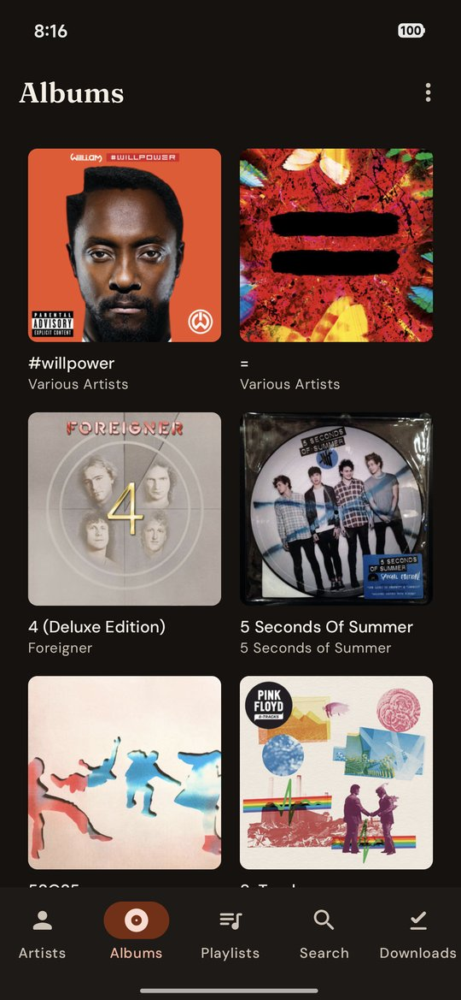
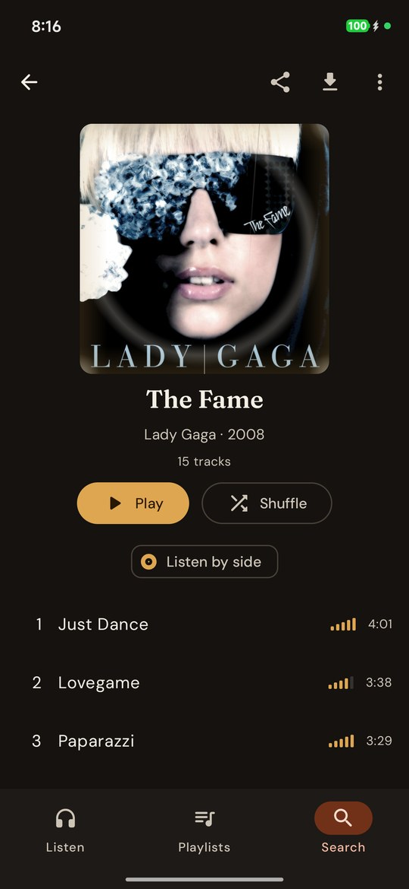
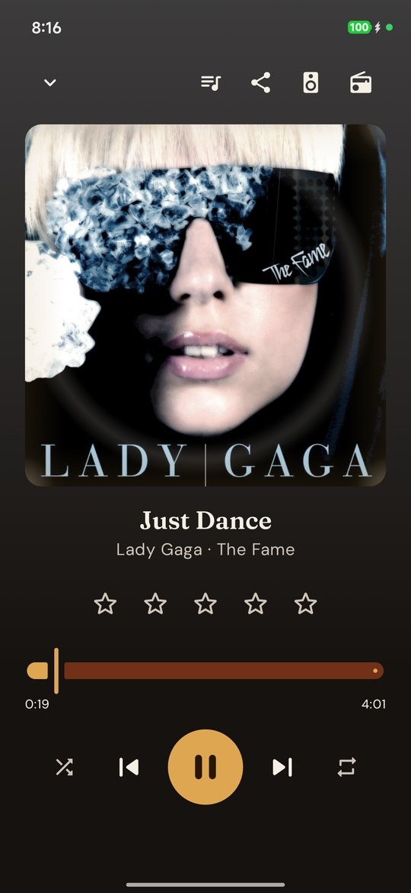
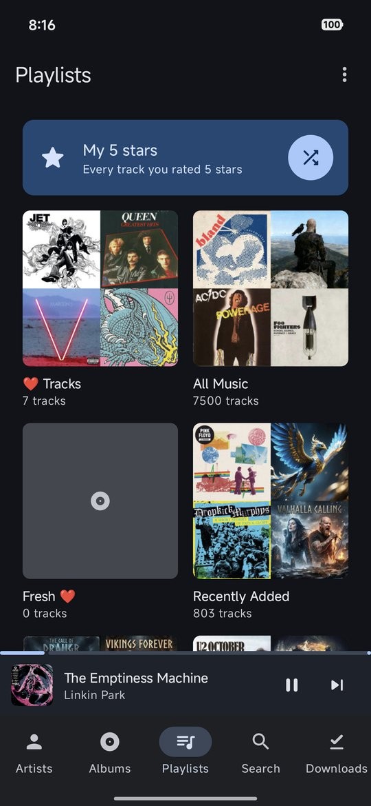
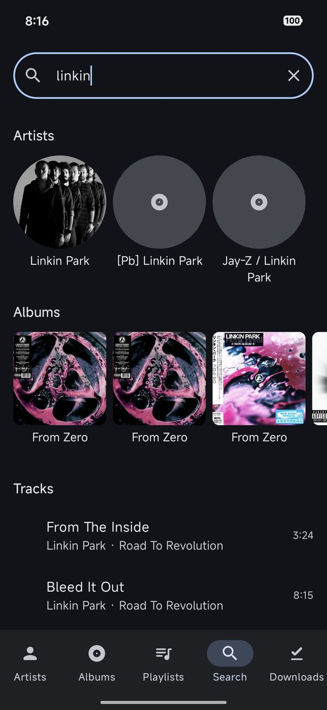
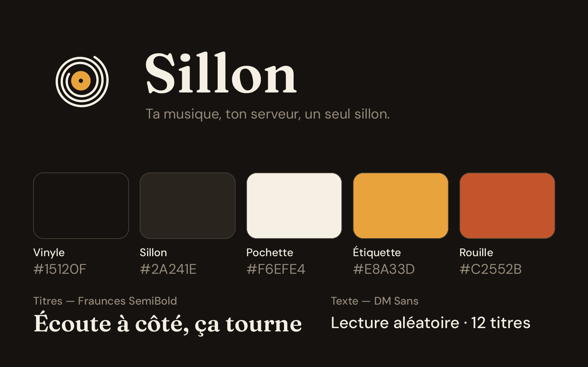

<p align="center">
  
</p>

<p align="center">
  <strong>Your own music, the way a music app should feel.</strong><br/>
  A free, open-source Android player for the music library on your Plex or Jellyfin server.
</p>

<p align="center">
  <a href="https://github.com/Wifsimster/sillon/releases/latest/download/app-release.apk"></a>
  <a href="https://github.com/Wifsimster/sillon/releases/latest"></a>
  
</p>

<p align="center">
  <sub>WORKS WITH</sub><br/>
  <a href="https://www.plex.tv/"></a>
  &nbsp;&nbsp;&nbsp;
  <a href="https://jellyfin.org/"></a>
</p>

<p align="center">
  
  
  
  
  
</p>

*Sillon* is French for the groove of a record — hence the logo: one continuous
groove spiralling to the label (see [DESIGN.md](DESIGN.md)). You keep your music on your own
server; Sillon makes it a pleasure to play on your phone, in the car and on the
go, with no ads, no tracking and no subscription.

## Why Sillon

- 🎧 **Made for music.** Albums, artists, playlists and search, gapless playback,
  big covers, a mini-player always within reach.
- 📻 **Radios.** Your server's library radios (Library, Deep Cuts, Time
  Travel…), Plex's *Mixes for you*, a radio for every artist, and from the
  player, a radio of tracks that sound like the one playing.
- 🧭 **Never played.** A radio of the tracks you have never heard, or an album you
  have never played, drawn at random. A card shows how much is still waiting.
- 💿 **Sleeve wear.** Covers age as you play them, like a real record: yellowed
  edges, worn corners, a ring. One switch in Settings turns it off.
- 👥 **Listen together.** Several phones play the same track at the same moment,
  through your own server. Jellyfin only: Plex offers no way to do it.
- 🎁 **Mystery sleeve.** One tap plays a whole album you rarely listen to,
  hidden behind a kraft sleeve in the app, the notification and the car. It
  reveals itself after the third track, or when you ask.
- ⭐ **Your taste, front and centre.** Your star ratings on every track,
  popularity bars to spot an album's hits, and **My 5 stars**: one tap shuffles
  every track you love.
- 🚗 **In the car.** Android Auto: browse your library with its covers on the
  dashboard, pick up where you stopped from the resume card, or say
  *"play … on Sillon"*.
- 💾 **Offline.** Download albums and playlists, Wi-Fi only by default, and
  listen with no connection at all.
- 🎚️ **Even volume.** Loudness levelling with the gains your server measured
  (ReplayGain), per track or per album, so a shuffle doesn't jump from a quiet
  70s record to a loud modern master.
- 📶 **Easy on your data plan.** Original quality on Wi-Fi, AAC at 320, 192 or
  128 kbps on mobile data, chosen separately and transcoded by your server.
- 🖥️ **Plex or Jellyfin.** Sign in to either; everything works with both,
  except listening together.
- 📊 **Your server stays in sync.** What you play shows under *Now playing* on
  your server, lands in the history and counts as played, like the official apps.
- 💌 **Music postcards.** From the player, an album or an artist, *Share a card*
  makes an image of the cover with the title, the artist and the year, square or
  story-sized, in three styles: Vinyl, Label and Polaroid. Add a few words, your
  rating, or two lines of the lyrics when your server has them. The card is drawn
  on your phone, carries no link and says nothing about your server, and it works
  offline with your downloads.
- 🔒 **Private.** No account but your server's, no analytics, no ads. Your
  server token never leaves the app.
- 🎨 **A look of its own.** Vinyl blacks, sleeve cream and label amber, titles in
  Fraunces, and a player tinted by the cover playing. Wallpaper colours
  (Material You) are one switch away. See [DESIGN.md](DESIGN.md).
- 🌍 **Open source**, in English and French.

## Get it

👉 **[Download the APK](https://github.com/Wifsimster/sillon/releases/latest/download/app-release.apk)**
from the latest release. Open the link on your phone, allow *install from
unknown sources* when Android asks, and open the file. No store account and no
GitHub account needed.

Then:

1. **Pick Plex or Jellyfin.**
2. **Sign in.**
   - *Plex*: in the browser, or by typing the code shown at
     [plex.tv/link](https://plex.tv/link) from another device. Then pick your
     server; Sillon finds the best way to reach it (home network, internet,
     Plex relay).
   - *Jellyfin*: type your server's address, then your user name and password,
     or approve the **Quick Connect** code from another Jellyfin app.
3. **Play.**

Every release ships a `SHA256SUMS.txt` to check the download against what CI
built: `sha256sum -c SHA256SUMS.txt`. Want the tip of `main`? The
[*latest* pre-release](https://github.com/Wifsimster/sillon/releases/tag/latest)
is rebuilt on every push.

## Everything it does

| | |
|---|---|
| **Library** | Artists, albums, playlists; search as you type; choice of music library when the server has several |
| **Playback** | Background play, notification and lock-screen controls, Bluetooth and headset buttons, gapless albums, shuffle, repeat, loudness levelling (per track or album) |
| **Sides** | *Listen by side*: an album played in order stops at the end of side A, like a record, until you flip it (in the app, the notification and Android Auto) |
| **Ratings** | Star ratings on tracks, popularity bars (Last.fm listeners via Plex), *My 5 stars* one-tap mix (*My favourites* on Jellyfin) |
| **Radios** | Plex library radios and artist radios (Jellyfin: library shuffle and Instant Mix), *Never played* (tracks or whole albums, Plex and Jellyfin), also in the car |
| **Surprise** | Mystery sleeve: a whole album drawn at random (rarely played first, or any album), hidden in the app, the notification, the lock screen and the car until the third track or *Reveal*; *Keep* adds it to a *Surprises* playlist; offline, drawn from your downloads |
| **Covers** | Sleeve wear: covers age with your plays (yellowed edges, worn corners, ring wear, a crease) on the album grids, the album page and the player; on by default, off in Settings → Appearance |
| **Together** | Listen together on Jellyfin (SyncPlay): shared play, pause, skip and seek; the notification, headset buttons and Android Auto control the group. Not available on Plex |
| **Car** | Android Auto browsing with covers (Artists, Albums, Playlists, Radios, My 5 stars), resume card, voice requests |
| **Resume** | The queue and position are remembered: *play* on a headset, Bluetooth or in the car resumes where the music stopped, even after the app was closed |
| **Offline** | Album and playlist downloads with covers, a Downloads tab that works with no network |
| **Data** | Streaming quality per network (Original / 320 / 192 / 128 kbps AAC), Wi-Fi-only downloads |
| **Plex** | PIN sign-in, owned and shared servers, automatic reconnection, play reports to the server |
| **Jellyfin** | Password or Quick Connect sign-in, HTTP or HTTPS servers, transcoding, play reports to the server, listen together (SyncPlay) |

## Identity

<p align="center">
  
</p>

One continuous groove spiralling to an amber label; vinyl black `#15120F`,
groove `#2A241E`, sleeve cream `#F6EFE4`, label amber `#E8A33D` and rust
`#C2552B`; Fraunces for titles, DM Sans for text. Logo files, the animated logo
(GIF and MP4, made with [Remotion](https://www.remotion.dev/) in
[`brand/animation`](brand/animation)) and the rules are in [DESIGN.md](DESIGN.md).

## Roadmap

1. A Windows desktop app.

Ideas and bug reports are welcome in the
[issues](https://github.com/Wifsimster/sillon/issues).

## Tech stack

| Concern     | Choice |
|-------------|--------|
| Language    | Kotlin 2.0 |
| UI          | Jetpack Compose + Material 3 |
| Playback    | AndroidX **Media3** (ExoPlayer, HLS, MediaLibraryService for Android Auto) |
| Server APIs | Plex and Jellyfin, over OkHttp + kotlinx.serialization |
| Storage     | Room (downloads), DataStore (session and settings, excluded from backups) |
| Background  | WorkManager (downloads) |
| DI          | Hilt |
| Images      | Coil |

`minSdk 26` (Android 8.0) · `targetSdk 36` · single-activity, MVVM.
The build, CI and release setup come from
[Ondes](https://github.com/Wifsimster/ondes), the podcast player of the same author.

## Project layout

```
app/src/main/java/ovh/battistella/sillon/
├─ data/plex/        Plex wire models, HTTP client, connection selection
├─ data/jellyfin/    Jellyfin client, mapped onto the same models
├─ data/session/     Account token + chosen server (DataStore)
├─ data/settings/    Settings, saved queue, never-played counts (DataStore)
├─ data/local/       Downloaded tracks (Room)
├─ data/network/     Wi-Fi / mobile data / offline monitor
├─ data/wear/        Sleeve wear: play counts per album, levels, cache
├─ data/repository/  PlexRepository: what the UI asks for, from Plex or Jellyfin
├─ download/         Download queue and WorkManager worker
├─ playback/         Media3 service, Android Auto tree, radios, play reports
├─ together/         Listen together: clock sync, session, drift correction
├─ ui/               Compose screens, navigation, theme, components
└─ di/               Hilt module
```

## Build

```bash
./gradlew testDebugUnitTest   # JVM unit tests
./gradlew assembleDebug       # → app/build/outputs/apk/debug/app-debug.apk
```

Requires JDK 17 and the Android SDK. Every push builds debug and release APKs
in GitHub Actions; pushes to `main` are released with semantic-release
(Conventional Commits).

## Notes

- **Plex** is only reached over HTTPS. Plex issues `*.plex.direct`
  certificates for every server address, and the token must not travel in
  clear text. If your server has *Secure connections* set to *Disabled*, set
  it to *Preferred*.
- **Jellyfin** servers can be reached over HTTP, as they usually are on a home
  network (`http://192.168.1.10:8096`). Without a scheme, Sillon tries HTTPS
  first. Jellyfin has no star ratings and no popularity figures: *My 5 stars*
  becomes *My favourites*, and tracks show no popularity bars.
- On Wi-Fi with *Original* quality, tracks play as the original files. Formats
  Android can't decode natively (ALAC on older devices, for example) play once a
  transcoded quality is chosen.
- Sonic features (*Mixes for you*, tracks that sound alike) need Plex Pass and
  *Sonic analysis* enabled on the music library; until the analysis has run,
  the track radio falls back to the artist's radio.
- *Never played* uses the play counts kept by your server (`viewCount` on Plex,
  `PlayCount` on Jellyfin). A track skipped within 30 seconds isn't offered
  again until the app restarts; nothing about skips is saved. Offline, the radio
  draws from your downloads, using the play counts saved the last time Sillon
  reached the server.
- *Listen together* uses Jellyfin's SyncPlay: your Jellyfin account must be
  allowed to use it, and gapless playback is off during a session. How it works
  and its limits: [docs/listen-together.md](docs/listen-together.md).
- A *Mystery sleeve* can't stay hidden from a listen together session, which
  shares the queue with every phone: it reveals itself when you join one, and
  can't be drawn during one.
- Loudness levelling only turns tracks down (the player can't amplify), as
  ReplayGain targets a quieter reference than most modern masters: with it on,
  turn the phone volume up a little. Plex needs *loudness analysis* enabled on
  the music library; Jellyfin computes the gains from 10.9 on.
- *Listen by side* uses the disc numbers from the server (sides A–B for disc 1,
  C–D for disc 2…) or side markers in the track titles (`A1`, `Side B`); without
  them, the album is cut at the track boundary closest to half its length.
  Albums under 12 minutes or with fewer than 4 tracks play straight through.
  Shuffle, radios and playlists are never cut, and sides are off while
  listening together (the group decides when to pause).
- Sillon is an independent client, not affiliated with Plex Inc. or the
  Jellyfin project. Plex and Jellyfin are trademarks of their owners; the logos
  come from [simple-icons](https://simpleicons.org/) (CC0). Screenshots show
  album covers from the author's own library.
